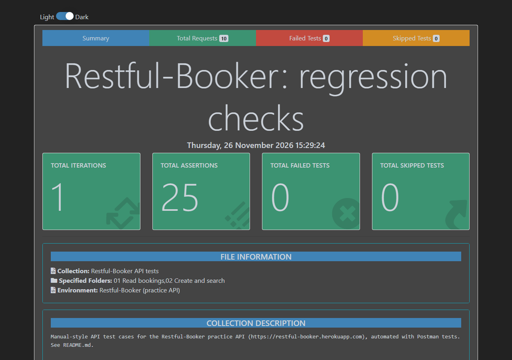
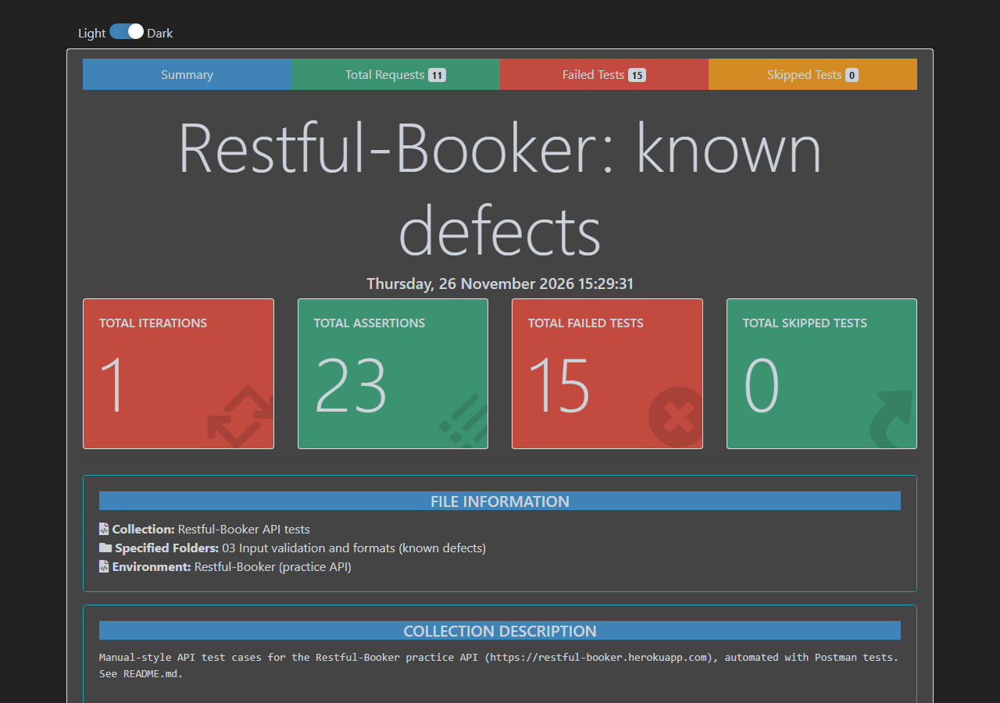

# API Testing with Postman and Newman: Restful-Booker

[](https://github.com/BENOURO/qa-postman-api-testing/actions/workflows/api-tests.yml)


A test plan, 31 API test cases, a Postman collection that runs from the terminal and in GitHub Actions, and **10 real bug reports** found in the [Restful-Booker](https://restful-booker.herokuapp.com) practice API, a public booking API built for testing practice.

## Results (first run, 2026-11-26)

| Folder | What it checks | Result |
|---|---|---|
| 01 Read bookings | status codes, field types, 404s, content type | 25 assertions, **0 failed** (together with folder 02) |
| 02 Create and search | create a booking, read it back, find it by search, text stored literally | |
| 03 Input validation and formats | what a careful API must refuse | 23 assertions, **15 failed**: 10 defects found, all reported |
| 04 Login and changes | tokens, 403 without a token, update, partial update, delete | written; not part of this evidence (needs the demo login, see below) |



The "known defects" report: these tests fail on purpose, and every failure is documented.



## Bugs found

Full reports with steps, expected and actual results, and severity: [`docs/BUG-REPORTS.md`](docs/BUG-REPORTS.md).

| ID | Defect | Severity |
|---|---|---|
| BUG-001 | Booking without a first name returns 500 instead of 400 | Medium |
| BUG-002 | Booking without dates returns 500 instead of 400 | Medium |
| BUG-003 | Empty request body returns 500 instead of 400 | Medium |
| BUG-004 | A text total price is accepted and silently saved as `null` | High |
| BUG-005 | A negative total price is accepted | Medium |
| BUG-006 | Check-out date before check-in date is accepted | Medium |
| BUG-007 | Impossible dates are accepted and stored as `0NaN-aN-aN` | High |
| BUG-008 | `depositpaid: "maybe"` is silently saved as `true` | Medium |
| BUG-009 | A 5,000-character first name is accepted | Low |
| BUG-010 | XML responses are sent with `Content-Type: text/html` | Low |

## What is in this repository

| Path | Content |
|---|---|
| `docs/TEST-PLAN.md` | scope, approach, environment, risks, entry and exit criteria |
| `docs/TEST-CASES.md` | the 31 test cases (generated from the collection, so it always matches) |
| `docs/BUG-REPORTS.md` | the 10 bug reports |
| `collections/` | the Postman collection (import it into Postman or run it with Newman) |
| `environments/` | the Postman environment |
| `scripts/` | generators for the collection and the test case list |
| `.github/workflows/api-tests.yml` | pipeline: regression checks must pass, defect checks are reported, HTML reports are kept |

## How to run it

You need [Node.js](https://nodejs.org) 20 or newer.

```
git clone https://github.com/BENOURO/qa-postman-api-testing.git
cd qa-postman-api-testing
npm install
npm run test:api
npm run test:defects
```

- `npm run test:api` runs the regression folders (they must pass).
- `npm run test:defects` runs the folder that is expected to fail and never makes the command fail.
- HTML reports are written to `reports/`.
- In Postman: **Import**, choose the files in `collections/` and `environments/`.

### The login and update tests (folder 04)

The API documentation page (https://restful-booker.herokuapp.com/apidoc/index.html) publishes a demo username and password for the practice API. Copy them into `environments/restful-booker.postman_environment.json` (`username` and `password`), then run:

```
npm run test:auth
```

They are not stored in this repository.

## Limits and honesty

- The API is a **public shared practice service** that resets its data. Tests create their own bookings with a unique name and never depend on other people's data. A failure that is not repeatable (for example a timeout) should be re-run before being reported as a bug.
- Folder 04 (login, update, delete) is written but was not run for the results above.
- This is practice work on a service made for it, not client work.

## License

MIT, see [`LICENSE`](LICENSE).
